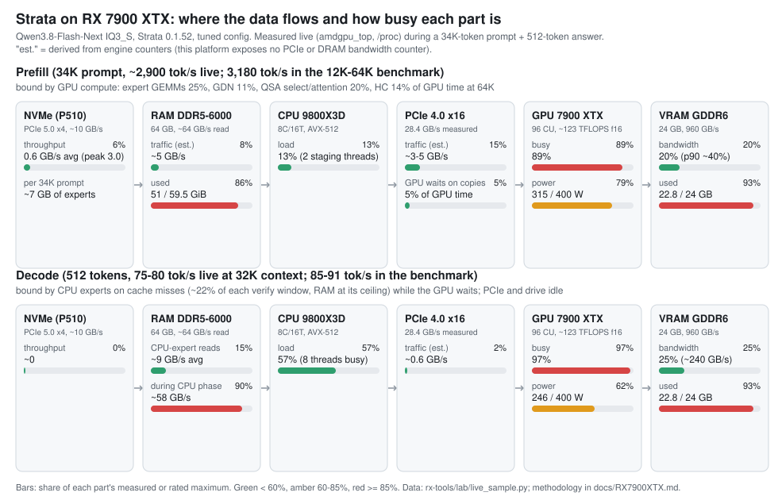

# Strata on an AMD Radeon RX 7900 XTX (gfx1100): tuned configuration, measurements and tools

This branch (`rx7900`) is upstream Strata engine 0.1.52 plus a small RX 7900 XTX toolkit (`rx-tools/`) and one planner
fix. Most of the speed comes from **opt-in switches that already exist in upstream Strata but are off on gfx1100**,
each measured here with interleaved A/B runs and an FP16 quality gate. You can use the configuration below with the
official Strata 0.1.52 HIP build; the fork is only needed for the tools.



## Result

Qwen3.8-Flash-Next IQ3_S (46.8 GiB of experts), one RX 7900 XTX 24 GB, Ryzen 7 9800X3D, 64 GB DDR5-6000.

| | starting point (official 0.1.52, before this work) | this configuration |
|---|---:|---:|
| prefill, 12K / 32K / 64K-token prompt | ~1,380 tok/s at 32K, **engine hangs on 32K+ prompts** | **3,159 / 3,178 / 3,178 tok/s**, no hangs |
| first token after a 64K prompt | - | 21.4 s |
| decode (512 tokens, 5K / 64K context) | ~80 tok/s | **85-91 tok/s** (single runs 75-98) |
| quality vs the exact FP16 path (first-token KL, 32 prompts) | 0.016-0.018 | 0.017, top-1 30-31 of 32 |

Prefill numbers are medians of 2 runs after a warm-up, noise 1-2%. Decode noise between two runs of the same config is
up to ~8%, so decode effects below ~5% were not taken as real (see [Measuring](#measuring)).

## Hardware it was measured on

| part | | measured ceiling |
|---|---|---|
| GPU | RX 7900 XTX 24 GB (gfx1100, 96 CU), Sapphire Nitro+, 400 W cap | ~84 TFLOPS in hipBLASLt GEMMs (~68% of ~123) |
| PCIe | 4.0 x16 from the CPU | 28.4 GB/s H2D (pinned, >= 1 MiB copies; 2.2 MB copy: 85 us) |
| CPU | Ryzen 7 9800X3D (Zen 5, one CCD, AVX-512) | CPU expert pool limited by DRAM, ~58 GB/s |
| RAM | 64 GB DDR5-6000 (EXPO) | ~64 GB/s read from one CCD |
| model drive | Crucial P510 (PCIe 5.0 x4), NTFS via ntfs3 | ~10 GB/s O_DIRECT, 2.5-4.4 GB/s through the page cache |
| OS | Ubuntu 26.04, kernel 7.0, ROCm: the official Strata HIP package; fork builds with TheRock 10.1 | |

## The configuration

A full server config (the strata-control JSON format) with placeholder paths is in
[`rx7900xtx/strata-rx.json`](rx7900xtx/strata-rx.json). What differs from the defaults, and what each change measured:

### Environment

| variable | what it does | measured on this card | numerics |
|---|---|---|---|
| `STRATA_UNBUFFERED_LOAD=1` | the file tier reads with O_DIRECT, not through the page cache | **removes the hangs**: with 64 GB RAM, page-cache reads triggered memory reclaim and `svm_range_restore_work` stalls of the GPU queues, 5 of 11 long prompts hung, 0 of 16 after | bitwise |
| `STRATA_PF_FUSED=1` | prompt experts on the gfx11 WMMA (matrix-core) MMQ kernels | together with the next one: **prefill +59-82%** (experts 3.5x) | rounding (KL as before) |
| `STRATA_HIP_WMMA=1` | prompt attention on WMMA | attention 4x | rounding |
| `STRATA_GDN_CHUNKED=1` | chunked gated-delta-net recurrence on WMMA | prefill +6-7% | rounding (KL better) |
| `STRATA_PF_F16=1 STRATA_PA_FAST=1 STRATA_HC_UPMIX=1` | FP16 prompt path pieces, faster prompt attention, HC up+mix fused | **prefill +7-10%** (each alone +1-3%) | rounding (KL in noise) |
| `STRATA_PF_GEMM=1 STRATA_PF_PAD=1` | Strata's own 128x256 WMMA GEMM for the dense prompt projections instead of hipBLASLt, padded rows | prefill +2.5-3.5% | rounding (KL in noise) |
| `STRATA_EXP_MODE=8 STRATA_HC_Q8=1` | grouped decode expert mode 8; int8 hyper-connection weights in decode | **decode +9-10%** (3 interleaved runs, every run above every baseline run) | HC_Q8: rounding |
| `STRATA_PREFILL_MMQ=1 STRATA_PREFILL_RING=256 STRATA_RESIDENT_PIN=1 STRATA_RESIDENT_HEADROOM_GIB=8` | (kept from the earlier setup) | | |

### Arguments

| argument | measured |
|---|---|
| `--prefill auto:24576` (instead of `auto:32768`) | **prefill +15% at 32K, +7% at 64K.** A 32K chunk needs such large buffers that the engine lends too many expert-cache slots; the experts evicted from them have no RAM copy and are read from the drive again (~10.5 GB per 32K chunk). 24K and 16K chunks measured the same; 24K keeps 16-24K prompts in one chunk |
| `--kv-resident 32768` | KV beyond 32K in pinned RAM: +17% expert slots in VRAM, prefill 12K +16.5%, decode at 64K +12% |
| `--spec 6 --spec-min-p 0.85` | decode +5% over 0.5-0.7 (4 runs) |
| `--resident-experts --resident-budget-gib 36` | 36 GiB of experts page-locked in RAM |
| `--kv int8 --max-context 200000 --vram-reserve-mib 3072 --pcie-frac 0.20 --pool-workers 7` | `--pcie-frac` 0.2-0.5, `--vram-reserve-mib` 2048-3072 and `--pool-workers` 6-8 were swept alone and as a 2x2x2 grid: no combination beat the noise |

## What did not help (so you do not have to try it)

| tried | result |
|---|---|
| batch mode (`--batch`) for 2-4 agents | slower than a queue: each slot takes VRAM from the expert cache (24 GB card). Queue: ~45-50 tok/s aggregate for 2-4 agents |
| `STRATA_FS_SLOTS` (Foresight swap space, 2/4/8 slots) | no gain. The next-layer router predicts only ~56% of the experts that will miss (precision ~36%), one layer ahead is too short: a third of the copies arrive late |
| `STRATA_PCIE_BALANCE=1` | +1-2% (noise); it keeps the misses on the CPU, correctly: a PCIe expert costs ~85 us serially, the 7-thread pool does ~3 experts in ~0.13 ms |
| `--spec-split` | decode -19% |
| hipBLASLt re-tuning for hipBLASLt 1.4 | the shipped table is already the best solution for 59 of 64 shapes |
| AVX-512 CPU expert kernels (T03 in this fork's history) | no gain: the CPU expert pool is DRAM-bound |
| `STRATA_EXPERT_V2`, `STRATA_TSUM`, `STRATA_ATTN_LANECELL`+`MERGE_V2`, `STRATA_GDN_SPLIT`, `STRATA_LFUSE`/`QFUSE`, the gfx12 default set | single runs looked +2-7%, combinations did not hold above the decode noise |
| `STRATA_PF_HCDOWN=1` | +1.3% prefill, but first-token KL at 16K doubled (one prompt 0.22): not used |
| `STRATA_GDN_CONVL2=1` | +0.3% |
| `--resident-budget-gib 40` + smaller conversation cache | less than the smaller prefill chunk, and less free RAM |

## Where the time goes now

- **Prefill** is GPU-compute bound (GPU busy ~89%, ~315 W). At 64K: expert GEMMs 25% of GPU time, GDN 11%, QSA select
  11% and attention 10%, hyper-connections ~14%, waiting for expert copies 5%. PCIe and RAM have plenty of headroom.
- **Decode** windows take 28-30 ms and accept ~2.95 tokens. GPU ~16 ms (55%), experts computed on the CPU after
  VRAM-cache misses 6.3-6.9 ms (22%, ~2.8 experts per layer), MTP draft ~3 ms (10%). The CPU branch runs beside the
  GPU's VRAM experts but is longer, so the GPU waits ~3 ms per window. DRAM is at its ceiling in that phase; PCIe is
  ~98% idle but slower per expert than the CPU pool.
- The decode projections (mmvq) already run at 70-100% of VRAM bandwidth (static audit). Remaining kernel ideas are
  worth 0.3-2.4% each.

## Measuring

`rx-tools/` builds the fork with TheRock 10.1 for gfx1100 and runs the parity tests and the benchmarks:

```sh
rx-tools/build.sh                 # engine -> build-rx/strata (+ hipBLASLt tuning tables beside it)
rx-tools/build.sh --tests && rx-tools/test.sh      # GPU parity tests of the kernels the fork touches
rx-tools/bench-detached.sh NAME prefill|decode|quality|all [EXE=prod|path] [STRATA_X=1 ...] [ARG--flag=value] [ARG--flag=]
```

`bench-detached.sh` copies your server config, writes a test variant (one change), restarts the server under
systemd --user, runs the benchmark and **always restores your config**. Results land in
`$RX_RESULTS/<time>-NAME/RESULT.txt` (prefill 12K/32K/64K, decode 5K/64K at 512 tokens, quality, drive reads).
Set your paths in `rx-tools/local.env` (ignored by git): `STRATA_CFG`, `STRATA_LOG`, `STRATA_UNIT`, `STRATA_URL`,
`HP` (TheRock), `RX_RESULTS`, `STRATA_DRIVE`, `STRATA_DRM_CARD`, `REF`.

**Quality reference.** `STRATA_LOGPOS` only covers tokens read by verify windows, not prefill, so prompt kernels are
checked with the first answer token's distribution (top-20 logprobs, temperature 0) on 24 ~4K and 8 ~16K prompts,
against the exact FP16 path, plus 4 agent tasks at temperature 0. Make your own reference once:

```sh
rx-tools/bench-detached.sh ref quality EXE=prod STRATA_PREFILL_MMQ=0 STRATA_PF_FUSED=0 STRATA_HIP_WMMA=0 \
  STRATA_GDN_CHUNKED=0 STRATA_PF_F16=0 STRATA_PA_FAST=0 STRATA_HC_UPMIX=0 STRATA_PF_GEMM=0 STRATA_PF_PAD=0
cp "$RX_RESULTS"/*-ref/quality.json rx-tools/lab/ref/R_fp16.json
```

(The reference is the FP16 prompt path without any of the rounding switches above; check in that run's engine log that
no "matrix cores" / WMMA line appears. The prompts are cut from the source tree, so a reference only matches runs made
from the same tree: `STRATA_CORPUS`.)

Other tools in `rx-tools/lab/`: `live_sample.py` (GPU/VRAM/power via [amdgpu_top](https://github.com/Umio-Yasuno/amdgpu_top),
CPU, RAM, drive at 250 ms during a prompt + answer: the data of the diagram), `drive_probe.py` (drive reads per prompt
length), `h2d_bw.hip` (PCIe ceiling by copy size), `flagb_latency.hip` (copy + completion-signal latency).

Rules that mattered:

1. One change per variant, a fresh server restart for each, the baseline measured at the start **and** the end.
2. Real, varied prompt text (source code), a unique tag at the start for prefill tests (no conversation cache) and at
   the end for decode tests; decode answers of at least 512 tokens (short answers under-read decode by ~25%).
3. After single-switch tests, measure the best combination as its own run: switches that share VRAM, PCIe, CPU threads
   interact, and several "wins" here vanished in combination.
4. Decode is noisy (~8%) and not run-to-run deterministic even at temperature 0 (which experts run on the CPU changes
   the rounding), so use 3+ interleaved runs, and check bitwise claims with kernel parity tests, not with agent outputs.
5. Check engine log numbers: the planner's "PCIe 12.0 GB/s" and "drive 2.50 GB/s" are defaults, not measurements
   (this fork's planner probes PCIe once: `STRATA_H2D_GBPS` overrides).
6. Watch the kernel log (`journalctl -k`: `svm_range`, amdgpu faults) after every variant: a hang is a result.

## Fork changes

- `rx-tools/`: build, parity tests, detached benchmark, `lab/` measurement scripts.
- T01 (`src/program/generate.cpp`): the prompt planner probes the real PCIe bandwidth once instead of assuming 12 GB/s
  (`STRATA_H2D_GBPS` overrides). No measurable prefill change on this card, but the planner's inputs are now right.

Credits: Strata by Niko1221 and contributors (MIT). Measurements, tools and this write-up: rxr2, with Claude Code.
The static GEMM/GDN audit behind the last round of switches is summarized in "Where the time goes now".
